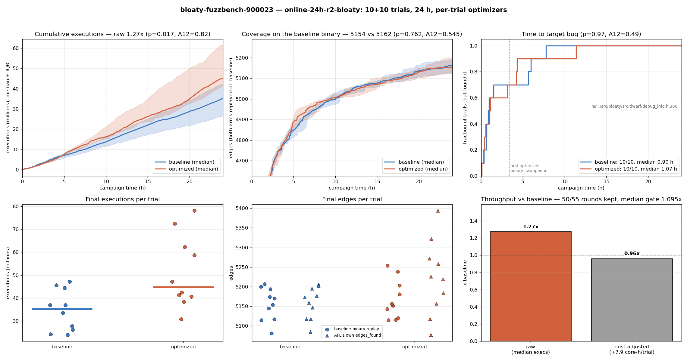
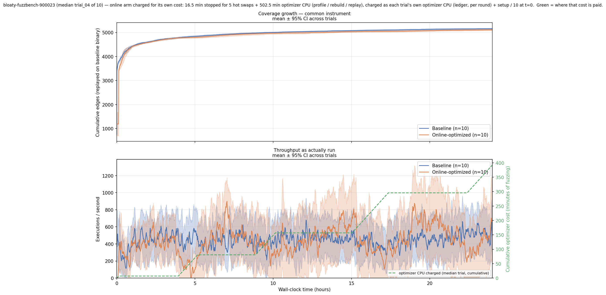

# online-24h-r2-bloaty — results

FuzzBench `bloaty_fuzz_target_52948c`, built exactly like FuzzBench aflplusplus
(parity build: static libc++, FuzzBench seeds/dict, cmplog). 10 baseline + 10
optimized trials, 24 h, one core each. Each optimized trial has its own optimizer
(Opus 5, `profile-once-fuzz-folds`) that starts a round 2 h after the previous one ends.
Run: Oct 15 17:39 – Oct 16 17:45 2026.

**Headline: optimization did not pay for itself, and the bug result is a tie.**

- The optimized arm ran 1.27x more executions (significant).
- After charging the optimizer's CPU, it is 0.96x.
- Coverage on a common instrument is tied.
- Both arms found the target bug in 10/10 trials at the same speed.
- The target bug is too shallow to separate the arms: 7 of the 10 optimized trials
  found it before their first optimized binary was swapped in.



## Numbers

Tests are two-sided Mann-Whitney U. A12 is the Vargha-Delaney effect size: the
probability that a random optimized trial beats a random baseline trial
(0.5 = no difference, above 0.5 = optimized better). "Beats" means more executions
or edges, or finding the target bug sooner.

| Metric | Baseline (median, range) | Optimized (median, range) | Ratio | p | A12 |
|---|---|---|---:|---:|---:|
| Executions | 35.2M (23.9–47.1M) | 44.8M (30.8–78.2M) | 1.27x | 0.017 | 0.82 |
| Edges on baseline binary | 5162 (5081–5207) | 5154 (5115–5254) | 1.00x | 0.76 | 0.55 |
| AFL `edges_found` (own binary) | 5166 (5085–5206) | 5222 (5077–5394) | 1.01x | 0.09 | 0.73 |
| Time to target bug | 0.90 h (0.01–7.8 h) | 1.07 h (0.10–11.4 h) | — | 0.97 | 0.51 |

**Cost-adjusted throughput: 0.96x.**

- The optimizer used 78.6 core-hours, which is 7.9 per trial. The formula is
  1.27 × 24 / (24 + 7.9).
- 69% of that cost is the agent timing its own candidate folds (`fold-replay-time`).
- Other costs:
  - build: 14%
  - campaign replay gate: 10%
  - profiling: 4%
- Hot-swap downtime was negligible: 1.4 min per trial.
- Model wait (94 h of wall time) is not counted, because it uses no local CPU.

**Coverage.** AFL's own `edges_found` counts edges of two different programs, so it
is not comparable across arms. The comparable number is from replaying both arms'
corpora on the baseline binary (`analysis/coverage_growth.py`), and that is tied.

The wall-clock plot charges the optimizer's CPU to the optimized arm as lost
fuzzing time. On that plot the optimized mean falls behind slightly from about 4 h
and stays behind:



**Optimizer rounds:**

- 55 rounds: 50 kept, 4 rejected (no speedup), 1 produced no fold.
- The median kept round's gate speedup is 1.095x.
- Multiplied per trial, the gate predicts 1.51–2.10x (median about 1.78x). The
  realized median is 1.27x.
- Per-trial realized ratios (0.88–2.22x vs the baseline median) are noisy. The
  baseline trials alone span 2x (23.9–47.1M execs).

## Bugs found by each arm

Crashes are deduplicated by sanitizer report (`analysis/dedup_crashes.py`). Each
artifact is replayed one-shot on the binary its trial was running when it crashed.

| Bug | Baseline | Optimized |
|---|---|---|
| **Target:** UBSan null member access, `CU::ReadTopLevelDIE` (`debug_info.h:360`) | **10/10**, first 0.01 h, median 0.90 h | **10/10**, first 0.10 h, median 1.07 h |
| SEGV in `ReadIndirectAddress` (`debug_info.h:342`): reads a CU's skeleton before it is set | 2/10 (15.4 h, 19.2 h) | 0/10 |

**Raw artifacts:**

- **Baseline:** 88, all reproduce.
- **Optimized:** 111, of which 105 reproduce. The other 6 are the OOM kills
  described below.

The raw counts are not comparable: the optimized arm restarts AFL after every swap,
and AFL saves the same bug again after each restart.

**The second bug** (2/10 vs 0/10, Fisher p = 0.47) is not evidence that the
optimizer hurt. Both inputs still crash every one of the 10 final optimized
binaries. The crash point moves with each binary's layout (`debug_info.h:258/259/342`,
`util.h:161`), but the cause and call path are the same. The optimized arm simply
never generated such an input.

**No bug was introduced by an optimization.** Every reproducing optimized crash is
the target bug, and reproduces on the baseline binary too.

## PoC check on optimized builds

The check is `tools/check_fuzzbench_pocs.py --experiment results/online-24h-r2-bloaty --per-trial`.

- It tests each trial's newest deployed binary and walks back only if a PoC fails.
- It ran two PoCs:
  - `poc_handbuilt.elf`;
  - `poc_fuzzer_found_r2.elf`, the smallest target-bug crash from this campaign
    (3080 B), which is now added to `data/fuzzbench_pocs/bloaty_fuzz_target_52948c/`.
- It also ran the `neg_control.elf` negative control.

| Trial | Newest binary | handbuilt | fuzzer_found_r2 | negative |
|---|---|---|---|---|
| 00 | iter_05 | yes | yes | clean |
| 01 | iter_06 | yes | yes | clean |
| 02 | iter_05 | yes | yes | clean |
| 03 | iter_06 | yes | yes | clean |
| 04 | iter_05 | yes | yes | clean |
| 05 | iter_05 | yes | yes | clean |
| 06 | iter_05 | yes | yes | clean |
| 07 | iter_06 | yes | yes | clean |
| 08 | iter_06 | yes | yes | clean |
| 09 | iter_05 | yes | yes | clean |

The bug reproduces on every newest binary, so no walk-back was needed: no fold
fixed or hid it. The baseline reproduces both PoCs.

## Agent side effect: OOM kills in optimized trial_01

The 6 non-reproducing optimized artifacts are all `sig:09`, and all come from trial_01.

- They are kernel memory-cgroup OOM kills against the 4 GB trial limit, between
  Oct 15 21:37 and 23:58. Each kill was at about 3.8 GB of RSS.
- They happened only while trial_01 ran its round-1 binary. That fold added:
  - a thread-local free list for `range_map` nodes, which never returns memory;
  - a process-lifetime capstone `id2insn` cache.
- One-shot, the same inputs use about 23 MB on every binary.
- So the likely cause is memory building up across iterations in AFL's persistent
  mode, where one process runs many inputs.
- Not proven: the same pool is still in trial_01's later binaries, yet the kills
  stopped after the round-2 swap.
- FuzzBench replays inputs one-shot, so this does not count as a bug. It cost
  trial_01 six restarts. No other trial had an OOM kill.

## Caveats

- **2 h between rounds.** This caps each trial at 5–6 rounds, and the first
  optimized binary arrives at about 3.4 h.
- **Auth errors.** There were 17 OAuth 401 failures over the run; rounds recovered
  after each.
- **Ledger tagging.** In `cpu_cost_report.py`'s per-round table, harness rows are
  tagged with the trial but `iter=0`. The total is correct, but the split between
  round 0 and the other rounds is not.

## Reproduce

```
export BENCHMARK_MANIFEST_PATH=$PWD/data/manifests/manifest_fuzzbench_bug.json
python3 analysis/coverage_growth.py --experiment-id online-24h-r2-bloaty --jobs 20
python3 analysis/dedup_crashes.py --experiment-id online-24h-r2-bloaty \
    --json-out results/online-24h-r2-bloaty/dedup_crashes.json
python3 analysis/plot_coverage_growth.py --experiment-id online-24h-r2-bloaty
python3 analysis/plot_bug_campaign_summary.py --experiment-id online-24h-r2-bloaty
python3 tools/check_fuzzbench_pocs.py --experiment results/online-24h-r2-bloaty --per-trial
```

All numbers above are in `results/online-24h-r2-bloaty/summary_stats.json`.
