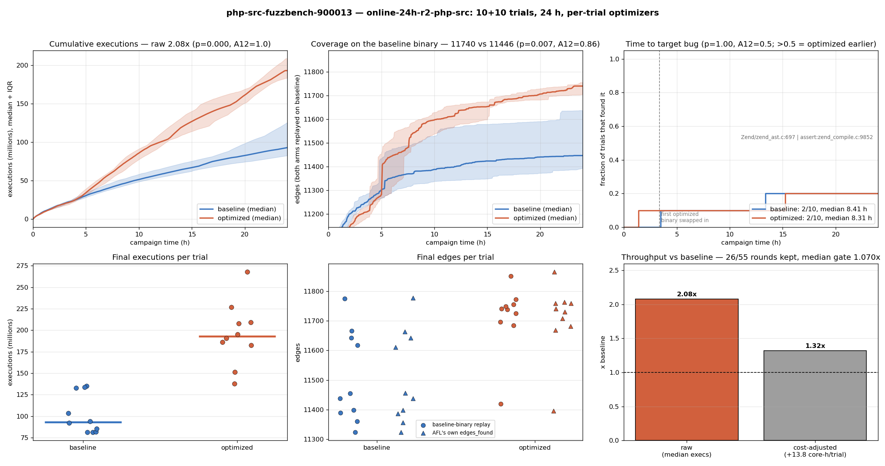
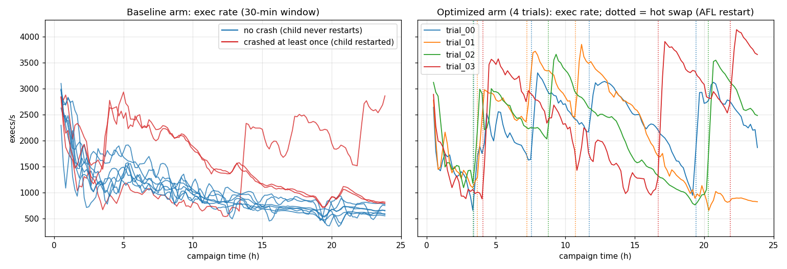

# online-24h-r2-php-src — results

FuzzBench `php_php-fuzz-parser_0dbedb`, built exactly like FuzzBench aflplusplus
(parity build, FuzzBench seeds/dict, cmplog). 10 baseline + 10 optimized trials,
24 h, one core each. Each optimized trial has its own optimizer (Opus 5,
`profile-once-fuzz-folds`), which starts a new round 2 h after the previous one ends.

Run: Oct 17 15:37 – Oct 18 15:42 2026. This is the second launch. The first (Oct 16)
was killed at 16 h and its data deleted, because of a build bug: one agent typedef
turned ccache off, and timed-out builds kept running. That bug was fixed in
`prework/fb_build.sh` and `sandbox/broker.py`. In this run, all ~400 agent builds
used the cache, and none timed out.

**Headline: the optimized arm ran 2.08x more executions and reached 2.6% more
coverage. Most of that comes from AFL restarts, not from the optimizations.**

- **Raw:** 2.08x executions, 1.32x after charging the optimizer's CPU.
- **Why that overstates the gain:** FuzzBench runs php's persistent loop with a
  count of 2,147,483,647, so the baseline's process never restarts. That process
  slows down about 3x over 24 h. Every hot swap restarts AFL with a fresh process,
  which resets the slowdown. The baseline arm never gets that reset.
- **The optimizations alone** give about 1.3x. Charged for the optimizer's CPU,
  that is about 0.83x.
- **Target bug:** tied, 2/10 vs 2/10.
- **Introduced bugs:** none.



## Numbers

Tests are two-sided Mann-Whitney U. A12 is the probability that a random optimized
trial beats a random baseline trial (0.5 = no difference, above 0.5 = optimized
better). "Beats" means more executions or edges, or finding the target bug sooner.

| Metric | Baseline (median, range) | Optimized (median, range) | Ratio | p | A12 |
|---|---|---|---:|---:|---:|
| Executions | 93.0M (81–135M) | 193.2M (138–268M) | 2.08x | 0.0002 | 1.00 |
| Edges on baseline binary | 11447 (11323–11775) | 11740 (11419–11851) | 1.026x | 0.007 | 0.86 |
| AFL `edges_found` (own binary) | 11447 | 11736 | 1.025x | 0.009 | 0.85 |
| Time to target bug | 2/10 (3.5 h, 13.4 h) | 2/10 (1.4 h, 15.2 h) | — | 1.00 | 0.50 |

**Cost.** The optimizer used 137.7 core-hours, which is 13.8 per trial:

| Stage | Share |
|---|---:|
| Agent builds (`broker_build`) | 41% |
| Setup: extra build to measure build-date noise | 22% |
| Agent fold timing (`broker_replay`) | 18% |
| Setup: ccache template build | 11% |
| Other | 8% |

The two setup builds (46 core-h) are a one-off per campaign. They exist only
because php needs ccache, and php needs the noise build.

## Where the 2.08x comes from

Before the first swap, both arms run the same binary at the same speed: 1888 vs
1855 execs/s in hours 0–3. After that, they split:

| Window | Baseline execs/s | Optimized execs/s |
|---|---:|---:|
| 0–3 h | 1888 | 1855 |
| 3–6 h | 1305 | 2505 |
| 6–12 h | 1046 | 2563 |
| 12–18 h | 825 | 1868 |
| 18–24 h | 697 | 2288 |



Three observations separate the restart effect from the optimizations:

1. **Baseline trials that crashed got faster.** A crash restarts the fuzzing child
   process, and nothing else changes.
   - Trials 06 and 08 crashed once at about 3.5 h. Their speed jumped from about
     1250 to 2300 execs/s, then slowed down again.
   - The three baseline trials that crashed (01, 06, 08) finished with 133–135M
     executions. The seven that never crashed finished with 81–104M.
2. **Optimized trials follow a sawtooth.** Speed jumps at every swap, then decays,
   in the same pattern as the baseline.
3. **Restarting with the final state confirms it.** I resumed two baseline trials'
   final AFL state in a fresh process for 25 min, on both binaries:

   | Queue | Baseline rate, last 3 h of trial | Fresh, baseline binary | Fresh, optimized binary (trial_04 iter_03) |
   |---|---:|---:|---:|
   | baseline trial_04 | 674 | 2788 | 3625 (1.30x) |
   | baseline trial_00 | 576 | 3575 | 4635 (1.30x) |

   A fresh process is 4–6x faster than the one that had been running for 24 h. On
   the same queue, the optimized binary is 1.30x faster. That matches the gate:
   per-trial compounded gate speedups are 1.08–1.30x, and the median kept round
   is 1.07x.

So the folds are worth about 1.3x. The rest of the 2.08x (realized per trial:
1.48–2.88x) is the swap restarts. The cause of the in-process slowdown was not
investigated: it could be php engine state, ASan's quarantine or fake stack, or
heap fragmentation.

The coverage gain (+2.6%, p = 0.007) is real on a common instrument. It probably
follows from the extra executions, so it inherits the same confound.

**What a fair comparison needs:** a control arm that runs the baseline binary and
restarts AFL on the same schedule as the optimized trials. Without it, the php
result cannot be credited to the optimizer.

## Optimizer rounds

- 55 rounds:
  - 26 kept;
  - 17 rejected (no speedup);
  - 9 produced no fold;
  - 3 cut off by the 24 h deadline while in progress.
- The median kept round's gate speedup is 1.07x.
- 4 OAuth 401 failures; rounds recovered after each.
- The ccache fix worked: every agent build hit the cache (about 684 of 689 files),
  with no "ccache off" builds and no build timeouts.

## Bugs found by each arm

Each of the 23 crash artifacts was replayed one-shot on the binary its trial was
running at the time (`analysis/dedup_crashes.py --count-asserts`). Asserts are
counted as bugs, keyed by their assert line, because the benchmark bug has an
assert form (GH-9136). A separate replay of every artifact on the baseline binary
(`results/online-24h-r2-php-src/crash_classes.json`) gives the same classes.

| Bug | Baseline | Optimized |
|---|---|---|
| **Target:** GH-9138/9136 const-expr bug, either the null access at `zend_ast.c:697` or the magic-constant assert in `zend_compile_const_expr_magic_const` | **2/10** (3.47 h assert, 13.36 h null) | **2/10** (1.38 h assert, 15.24 h assert) |
| Assert `0` in `zend_compile_const_expr_class_name` (`zend_compile.c:9818`, enum + attribute input) | 1/10 (3.48 h) | 0/10 |

- **The optimized 1.38 h find came before that trial's first swap,** so it was made
  by the baseline binary. Only one optimized find (trial_04 at 15.2 h, on its
  iter_03 binary) used an optimized binary.
- **The class-name assert** is in the same const-expr compile code as the target
  bug and may share its root cause. It is not in the PoC manifest. 1 vs 0 means
  nothing.
- **Raw artifacts:** 12 baseline, 11 optimized. All reproduce, on the live binary
  and on the baseline binary.
- **No bug was introduced by an optimization,** and there were no OOM kills.

## PoC check on optimized builds

`tools/check_fuzzbench_pocs.py --experiment results/online-24h-r2-php-src --per-trial`:
both PoCs (`poc_gh9138_segv.php`, `poc_gh9136_assert.php`) reproduce on every
trial's newest deployed binary, and the negative control is clean. No walk-back
was needed, so no fold fixed or hid the bug.

## Caveats

- **Restart confound.** This is the main caveat, described above. It also applies
  to any other target whose persistent process slows down over time. bloaty showed
  the opposite (realized below gate), so the effect is target-specific.
- **Setup cost.** It is charged to the optimizer arm. Without the two setup builds
  the cost would be 9.2 core-h per trial.
- **Target bug rate.** 2/10 per arm is too few for a time-to-bug comparison.

## Reproduce

```
export BENCHMARK_MANIFEST_PATH=$PWD/data/manifests/manifest_fuzzbench_bug.json
E=online-24h-r2-php-src
python3 analysis/coverage_growth.py --experiment-id $E --jobs 16
python3 analysis/dedup_crashes.py --experiment-id $E --count-asserts \
    --json-out results/$E/dedup_crashes.json
python3 tools/check_fuzzbench_pocs.py --experiment results/$E --per-trial
python3 analysis/plot_coverage_growth.py --experiment-id $E
python3 analysis/plot_bug_campaign_summary.py --experiment-id $E \
    --target-bug zend_ast.c:697 zend_compile.c:9852
```

`--target-bug` merges the two forms of the target bug into one, so a trial finds it
at its first hit of either form. The numbers are in
`results/online-24h-r2-php-src/summary_stats.json`.
